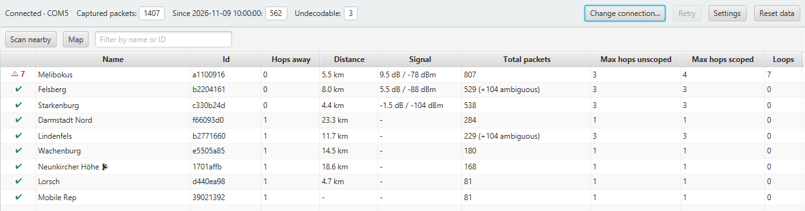
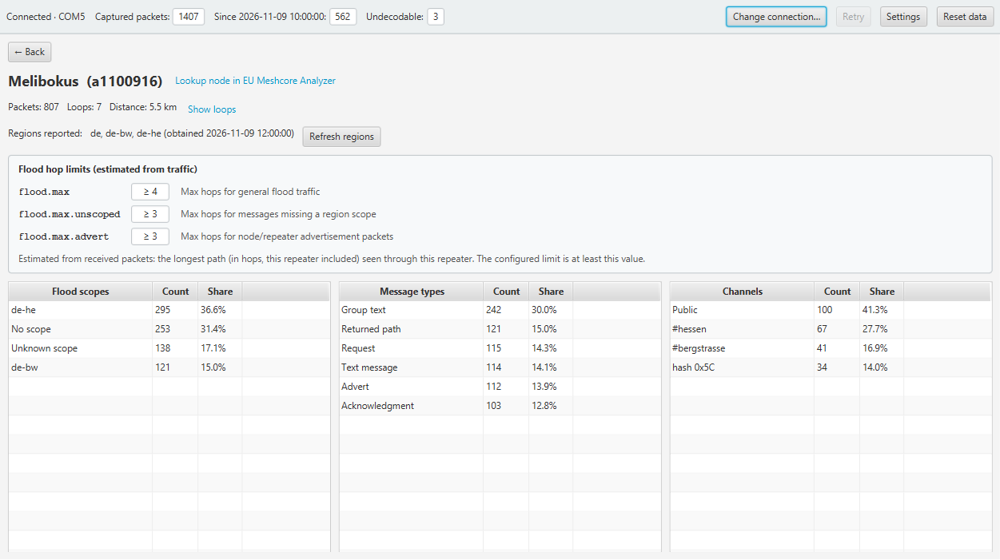
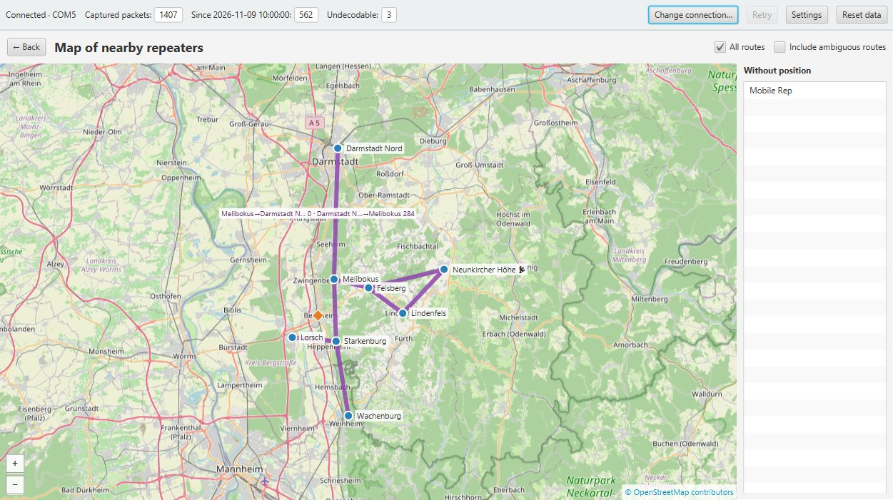

# MeshCore Repeater Packet Analyzer – User Guide

*Deutsche Fassung: [README_de.md](README_de.md)*

**Why this project?** Web-based MeshCore analyzers are a great way to inspect the overall network of
a whole country. This project has a different aim: the **local** analysis of the repeaters right next to
you, without sending any packet or repeater data to the internet. With MeshCore we build a
distributed, resilient network – so there should also be tools that analyze it independently of
central web infrastructure. Think of it as a Swiss army knife
for your personal MeshCore repeaters – it helps you fine-tune their settings and make the right
choices, for example when deciding on forward-filter firmware.

The analyzer connects to your MeshCore companion radio, listens to every packet the radio receives,
and shows which nearby repeaters carry how much traffic: by flood scope (region), message type and
channel. It also finds packets that loop through a repeater and draws the repeaters and their routes
on a map.

> **Note:** All screenshots in this guide show fictional demo data. The repeaters, their names,
> IDs, positions and traffic figures are made up and do not belong to any real MeshCore network.

## Contents

- [MeshCore Repeater Packet Analyzer – User Guide](#meshcore-repeater-packet-analyzer--user-guide)
  - [Contents](#contents)
  - [1. Getting started](#1-getting-started)
    - [Requirements](#requirements)
    - [Installation](#installation)
    - [Starting the application](#starting-the-application)
    - [Connecting to the companion](#connecting-to-the-companion)
  - [2. The main window](#2-the-main-window)
  - [3. Overview](#3-overview)
  - [4. Repeater details](#4-repeater-details)
  - [5. Loops](#5-loops)
  - [6. Map](#6-map)
    - [Routes](#routes)
  - [7. Settings](#7-settings)
  - [8. What the analyzer transmits](#8-what-the-analyzer-transmits)
  - [9. Stored data and reset](#9-stored-data-and-reset)
  - [10. Troubleshooting](#10-troubleshooting)
  - [11. License](#11-license)
  - [12. No Warranty](#12-no-warranty)
  - [13. AI disclosure](#13-ai-disclosure)

## 1. Getting started

### Requirements

- Windows 10 or 11.
- A MeshCore companion radio, connected by **USB** or with **Bluetooth LE** firmware (the PC then
  needs a Bluetooth LE adapter).
- Internet access only for the map background and for updating the community catalogs; everything
  else works offline.

### Installation

1. Open the **Releases** page of this GitHub repository (link "Releases" on the right-hand side of
   the repository page) and download the ZIP file of the newest release.
2. Unpack the ZIP file into a folder of your choice, for example `C:\Tools`; this creates the
   program folder `C:\Tools\MeshCoreAnalyzer`. A folder below your user profile works without
   administrator rights.

Nothing else needs to be installed: the folder contains the program and its own Java runtime.

- **Update:** delete the old program folder and unpack the newer release (or unpack it into a new
  folder). Your data and settings are kept, because they are stored separately (see
  [Stored data and reset](#9-stored-data-and-reset)).
- **Uninstall:** delete the program folder. To remove your data as well, delete
  `%APPDATA%\MeshCoreAnalyzer\`.

### Starting the application

Start `MeshCoreAnalyzer.exe` in the unpacked folder. The program is not code-signed, so Windows
SmartScreen may warn on the first start ("More info" → "Run anyway").

### Connecting to the companion

At every start the dialog **Connect to companion** asks how to reach the radio. Your last choice is
preselected; nothing connects until you click **Connect**.

- **USB:** choose the serial port. Click **Refresh** if you plugged in the radio after opening the
  dialog.
- **Bluetooth:** the analyzer searches 5 seconds for MeshCore radios (**Scan again** repeats the
  search) and shows name, address, signal and whether the radio is already paired.

**First Bluetooth connection:** Windows has to pair with the radio once. The pairing assistant opens
the Windows Bluetooth settings (**Open Bluetooth settings**); choose *Add device → Bluetooth*, select
the radio and enter the PIN shown on its display (or `123456` for radios without a display). Then
click **Retry**. Windows remembers the pairing; later connections need no PIN. The analyzer never
sees or stores the PIN.

If the connection is lost, the analyzer reconnects to the same radio by itself.

## 2. The main window

The **status bar** at the top is always visible:

| Element | Meaning |
|---------|---------|
| Connection state | `Connected · <port or radio>`, `Connecting…`, `Reconnecting: …`, `Disconnected`, `Pairing needed – click to pair` or `Error: …` |
| Counters | Captured packets in total, since the current session started, and undecodable packets |
| **Change connection…** / **Connect…** | Switch between USB and Bluetooth or to another radio, without restarting |
| **Settings** | Opens the [settings](#7-settings) |
| **Reset data** | Deletes captured packets and statistics, see [Stored data and reset](#9-stored-data-and-reset) |

Below the status bar you see one of the screens described next. Every screen has a **← Back**
button that returns to the previous one.

## 3. Overview

The overview is the start screen. It lists the repeaters near your companion, by default those in
direct range (0 hops) and one hop beyond; change this with "Show repeaters up to (hops)" in the
settings. The list updates continuously while packets arrive.

| Column | Content |
|--------|---------|
| (first column) | Green check: no loops seen. Red warning with a number: loops were seen – click it to open the [loop list](#5-loops) |
| Name, Id | Repeater name and the first 8 characters of its public key |
| Hops away | Fewest hops of any known path to the repeater |
| Distance | Straight-line distance from your companion; shown only when the companion's own position is known |
| Signal | SNR and RSSI from the last scan; `-` if the repeater did not answer |
| Total packets | Packets that went through this repeater; `(+N ambiguous)` counts packets that may also belong to another repeater |
| Max hops unscoped / scoped | Longest path (in hops, this repeater included) of a flood packet without / with a region scope |
| Loops | Number of looping packets |

Default order: nearest first, then strongest signal, then most packets. Click a column header to sort
differently. **Click a row** (or press Enter) to open the [repeater details](#4-repeater-details).

**Filter:** type into the field *Filter by name or ID* to show only repeaters whose name contains the
text or whose ID starts with it (upper/lower case does not matter). Clear the field to see all
repeaters again.

**Scan nearby** asks the repeaters in direct range to identify themselves; they answer with their
signal. The analyzer does this once automatically after connecting. Repeaters answer at most 4 times
per 2 minutes. Repeaters found this way show their ID until their name is known.

**Map** opens the [map](#6-map).

## 4. Repeater details

The detail page of a repeater shows:

- **Header:** name and ID, total packets, loops (**Show loops** opens the loop list), distance and
  maximum hops. **Lookup node in EU Meshcore Analyzer** opens the repeater's page on
  meshcore-analyzer.eu in your browser.
- **Regions reported:** the regions this repeater says it knows, with the time of the answer.
  **Refresh regions** asks again (only for repeaters in direct range or with a known route).
- **Flood hop limits (estimated from traffic):** the longest flood paths seen through this repeater.
  The repeater's configured limit is at least this value.
- **Three lists:** *Flood scopes* (regions, `Unknown scope`, `No scope`), *Message types* and
  *Channels* (name if known, otherwise `hash 0xNN`), each with count and share.

**Filter by scope:** click a line in *Flood scopes* to restrict *Message types* and *Channels* to
that scope; their headings then show the scope, e.g. `Channels – de-he`. Click the line again to
remove the filter.

## 5. Loops

A loop is a packet whose path contains the same repeater more than once. The loop list shows, newest
first, every such packet with time, message type, hop count and the full path; the repeater is
highlighted wherever it appears.

The **Kind** column says how certain the loop is:

| Kind | Meaning |
|------|---------|
| Loop | The path clearly contains the repeater twice |
| Probable loop | Certain only after excluding repeaters that are too far apart (see "Longest radio hop") |
| Possible loop | The short path IDs could also belong to other repeaters |

Path entries that match more than one repeater are marked with `?`. Only packets that use at least
the "Minimum path hash size" count as loops (see [Settings](#7-settings)).

## 6. Map

**Map** on the overview shows the overview repeaters with a known position on a street map, together
with your companion (orange diamond). Repeaters without a position are listed on the right.

- **Move and zoom:** drag the map; zoom with the mouse wheel, by double-clicking, or with the **+** /
  **−** buttons in the bottom-left corner.
- **Repeater menu:** click a repeater for *Show routes of …* (see below) and *Open details*.

### Routes

A route line connects two repeaters that appeared directly next to each other in a packet path.

- **All routes** shows all routes. Lines are drawn only when both repeaters are in the visible area,
  so zooming in reduces clutter.
- **Single repeaters:** in a repeater's menu, *Show routes of …* switches its routes on or off. While
  all routes are on, switching one repeater off hides its lines and the *All routes* box appears
  partly ticked; clicking it then switches everything off.
- **Counts:** hover a line to see the number of packets in each direction; click it to pin the counts
  as a label, click again to remove it.

By default only **stable routes** are drawn: routes confirmed by at least one packet whose path
clearly identified both repeaters. Their counts include uncertain packets and show that share, e.g.
`55 (5 uncertain)`. A route seen only through uncertain packets may not exist at all; it appears as a
**dashed** line only when **Include ambiguous routes** is ticked. If you switch on a repeater that has
no route, the map shows *No routes known for …*.

The map background is loaded from OpenStreetMap and needs internet access. Offline the background
stays grey, but repeaters and routes are still shown.

## 7. Settings

| Section | Setting | Default | Effect |
|---------|---------|---------|--------|
| Overview | Show repeaters up to (hops) | 1 | How far away a repeater may be to be listed |
| Capture | Maximum stored packets | 10,000 | When reached, the oldest packets are deleted; statistics then cover the kept packets only |
| Region Names | List of region names | empty | Names the analyzer can use to label scoped packets, in addition to those reported by repeaters |
| Channel Names | List of hashtag channels | empty | Your own channels (e.g. `#my-channel`) so their packets are named |
| Region Lookup | Ask nearby repeaters for their regions | on | Sends small, rate-limited requests (see [below](#8-what-the-analyzer-transmits)) |
| Loop Detection | Longest radio hop (km) | 25 | Repeaters further apart are not taken for the same path entry; 0 switches this off |
| Loop Detection | Minimum path hash size (bytes) | 2 | Only packets with at least this path ID size can show loops |
| Community Catalogs | Update catalogs now | – | Downloads the newest public channel and region catalogs |

**Names of regions and channels:** packets only carry short codes. The analyzer names them from the
answers of repeaters, your lists in the settings and the bundled community catalogs. Regions found
only in the catalog are shown as `name (catalog)`. Packets keep the label they were captured with;
changing the lists only affects new packets.

## 8. What the analyzer transmits

The analyzer mostly listens. It transmits only:

- **one short discovery request** after each connection and whenever you click **Scan nearby**;
- **region requests** to repeaters in range (at most one every 30 seconds, once per repeater per day)
  – switch this off with "Ask nearby repeaters for their regions".

Message contents are never decrypted or stored.

**Internet:** the analyzer never uploads captured packets or repeater data. It only downloads map
tiles from OpenStreetMap for the map background and, when you click **Update catalogs now**, the
community catalogs. **Lookup node in EU Meshcore Analyzer** opens a web page only when you click it.

## 9. Stored data and reset

All data is kept in `%APPDATA%\MeshCoreAnalyzer\`: captured packets (without message contents), the
known repeaters, your settings, downloaded catalogs and cached map tiles. Statistics are rebuilt from
the stored packets at every start, so they survive restarts.

**Reset data** in the status bar deletes the captured packets and statistics; repeaters and settings
are kept. Tick *Also reset repeater data* to also forget learned regions, distances and names.

## 10. Troubleshooting

| Problem | What to do |
|---------|------------|
| No serial port in the list | Plug in the radio, then click **Refresh**. |
| Bluetooth radio not found | Make sure the radio has Bluetooth firmware and is not connected to a phone; click **Scan again**. |
| Status says "Pairing needed" | Click it and follow the [pairing steps](#connecting-to-the-companion). |
| Overview stays empty | Wait for traffic; check "Show repeaters up to (hops)" in the settings. |
| A repeater shows only its ID | Its name appears once the companion knows it as a contact or one of its adverts is received. |
| Map background is grey | No internet connection; repeaters and routes still work. |
| Few or no routes on the map | Tick **Include ambiguous routes**, or zoom out so both repeaters are visible. |

## 11. License

The MeshCore Repeater Packet Analyzer may be used **for private, non-commercial purposes only**.

The reason is the Bluetooth support: it relies on the SimpleBLE library (SimpleJavaBLE), which is
licensed under the Business Source License 1.1 (BUSL-1.1) and allows non-commercial use only. Any
commercial use requires a commercial SimpleBLE license.

The licenses of all included third-party components are in the `legal` folder of the distribution;
`legal\THIRD-PARTY-NOTICES.txt` gives an overview. Map data © OpenStreetMap contributors.

## 12. No warranty

This project is provided **as is**, without warranty of any kind, express or implied, including but not limited to the warranties of merchantability, fitness for a particular purpose, and non-infringement.  The authors and copyright holders are not liable for any claim, damages, or other liability arising from or in connection with the software or its use. You use it at your own risk.   

## 13. AI disclosure

This application and its documentation were developed with the help of AI coding assistants. The
author defined the requirements, made the design decisions, and reviewed and tested the results,
including checking the application by hand. Large parts of the source code,
the automated tests, this guide, its German translation and the screenshots were produced with AI
assistance.

---

Made with ❤️ by 🦁GUSA_1🚫 @ #bergstrasse
