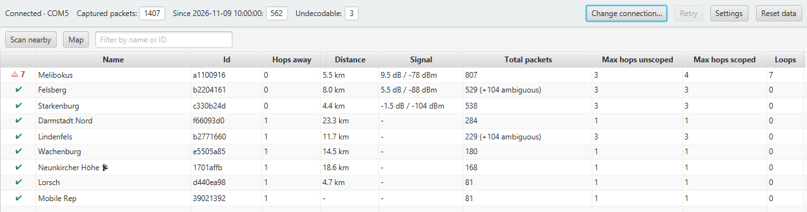
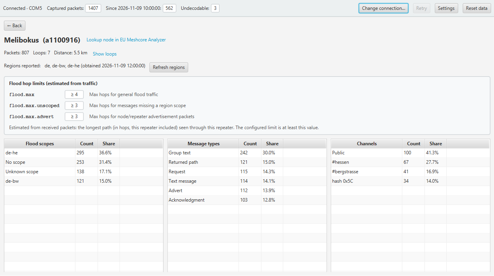
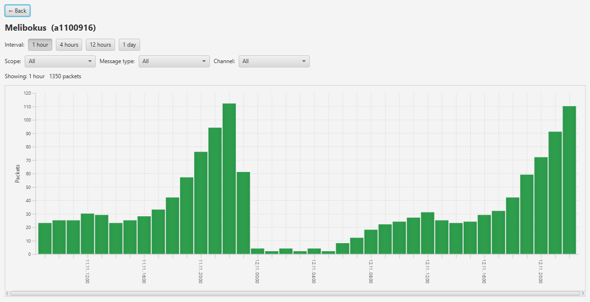
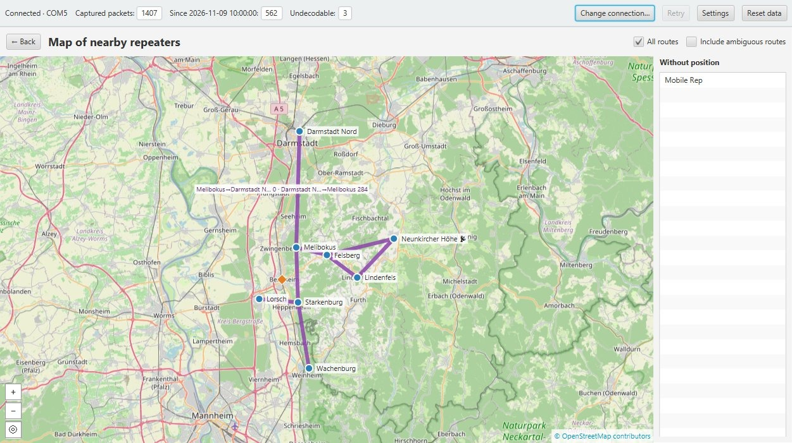

# MeshCore Repeater Packet Analyzer – Benutzerhandbuch

*English version: [README.md](README.md)*

**Warum dieses Projekt?** Web-basierte MeshCore-Analyzer sind eine prima Möglichkeit, das gesamte
Netz eines Landes zu untersuchen. Dieses Projekt verfolgt ein anderes Ziel: die **lokale** Analyse der
Repeater direkt in Ihrer Nähe, ohne Paket- oder Repeater-Daten ins Internet zu senden. Mit MeshCore
bauen wir ein verteiltes, ausfallsicheres Netz auf – daher sollte es auch Werkzeuge geben, die es
unabhängig von zentraler Web-Infrastruktur analysieren. Es ist eine
Art Schweizer Taschenmesser für Ihre eigenen MeshCore-Repeater – es hilft Ihnen, deren
Einstellungen fein abzustimmen und die richtigen Entscheidungen zu treffen, zum Beispiel bei der
Wahl einer Forward-Filter-Firmware.

Der Analyzer verbindet sich mit Ihrem MeshCore-Companion-Funkgerät, hört jedes Paket mit, das das
Gerät empfängt, und zeigt, welche Repeater in der Nähe wie viel Verkehr transportieren: nach
Flood-Scope (Region), Nachrichtentyp und Kanal. Außerdem findet er Pakete, die über einen Repeater
im Kreis laufen (Schleifen), und zeigt die Repeater und ihre Routen auf einer Karte.

Die Bedienoberfläche ist englisch; Beschriftungen von Schaltflächen und Feldern stehen deshalb in
diesem Handbuch im englischen Original.

> **Hinweis:** Alle Bildschirmfotos in diesem Handbuch zeigen erfundene Beispieldaten. Die Repeater,
> ihre Namen, IDs, Positionen und Verkehrszahlen sind frei erfunden und gehören zu keinem realen
> MeshCore-Netz.

## Inhalt

- [MeshCore Repeater Packet Analyzer – Benutzerhandbuch](#meshcore-repeater-packet-analyzer--benutzerhandbuch)
  - [Inhalt](#inhalt)
  - [1. Erste Schritte](#1-erste-schritte)
    - [Voraussetzungen](#voraussetzungen)
    - [Installation](#installation)
    - [Programm starten](#programm-starten)
    - [Mit dem Companion verbinden](#mit-dem-companion-verbinden)
  - [2. Das Hauptfenster](#2-das-hauptfenster)
  - [3. Übersicht](#3-übersicht)
  - [4. Repeater-Details](#4-repeater-details)
    - [Zeitverlauf](#zeitverlauf)
  - [5. Schleifen](#5-schleifen)
  - [6. Karte](#6-karte)
    - [Routen](#routen)
  - [7. Einstellungen](#7-einstellungen)
  - [8. Was der Analyzer sendet](#8-was-der-analyzer-sendet)
  - [9. Gespeicherte Daten und Zurücksetzen](#9-gespeicherte-daten-und-zurücksetzen)
  - [10. Fehlerbehebung](#10-fehlerbehebung)
  - [11. Lizenz](#11-lizenz)
  - [12. Keine Gewährleistung](#12-keine-gewährleistung)
  - [13. Hinweis zum KI-Einsatz](#13-hinweis-zum-ki-einsatz)

## 1. Erste Schritte

### Voraussetzungen

- Windows 10 oder 11.
- Ein MeshCore-Companion-Funkgerät, angeschlossen per **USB** oder mit **Bluetooth-LE**-Firmware
  (der PC braucht dann einen Bluetooth-LE-Adapter).
- Internet nur für den Kartenhintergrund und zum Aktualisieren der Community-Kataloge; alles andere
  funktioniert offline.

### Installation

1. Öffnen Sie die Seite **Releases** dieses GitHub-Repositorys (Link „Releases“ rechts auf der
   Repository-Seite) und laden Sie die ZIP-Datei des neuesten Releases herunter.
2. Entpacken Sie die ZIP-Datei in einen Ordner Ihrer Wahl, zum Beispiel `C:\Tools`; dabei entsteht
   der Programmordner `C:\Tools\MeshCoreAnalyzer`. Ein Ordner unterhalb Ihres Benutzerprofils
   funktioniert ohne Administratorrechte.

Weiteres muss nicht installiert werden: Der Ordner enthält das Programm und eine eigene
Java-Laufzeitumgebung.

- **Aktualisieren:** Löschen Sie den alten Programmordner und entpacken Sie das neuere Release (oder
  entpacken Sie es in einen neuen Ordner). Ihre Daten und Einstellungen bleiben erhalten, da sie
  getrennt gespeichert werden (siehe
  [Gespeicherte Daten und Zurücksetzen](#9-gespeicherte-daten-und-zurücksetzen)).
- **Deinstallieren:** Löschen Sie den Programmordner. Um auch Ihre Daten zu entfernen, löschen Sie
  zusätzlich `%APPDATA%\MeshCoreAnalyzer\`.

### Programm starten

Starten Sie `MeshCoreAnalyzer.exe` im entpackten Ordner. Das Programm ist nicht signiert; Windows
SmartScreen kann deshalb beim ersten Start warnen („Weitere Informationen“ → „Trotzdem ausführen“).

### Mit dem Companion verbinden

Bei jedem Start fragt der Dialog **Connect to companion**, wie das Funkgerät erreicht wird. Ihre
letzte Wahl ist vorausgewählt; verbunden wird erst, wenn Sie auf **Connect** klicken.

- **USB:** Wählen Sie die serielle Schnittstelle. Klicken Sie auf **Refresh**, wenn Sie das Gerät
  erst nach dem Öffnen des Dialogs angeschlossen haben.
- **Bluetooth:** Der Analyzer sucht 5 Sekunden lang nach MeshCore-Geräten (**Scan again** wiederholt
  die Suche) und zeigt Name, Adresse, Signal und ob das Gerät bereits gekoppelt ist.

**Erste Bluetooth-Verbindung:** Windows muss einmalig mit dem Gerät gekoppelt werden. Der
Kopplungsassistent öffnet die Windows-Bluetooth-Einstellungen (**Open Bluetooth settings**). Wählen
Sie dort *Gerät hinzufügen → Bluetooth*, dann das Funkgerät, und geben Sie die PIN ein, die auf
seinem Display steht (oder `123456` bei Geräten ohne Display). Klicken Sie danach auf **Retry**.
Windows merkt sich die Kopplung; spätere Verbindungen brauchen keine PIN. Der Analyzer sieht und
speichert die PIN nie.

Bricht die Verbindung ab, verbindet sich der Analyzer selbstständig wieder mit demselben Gerät.

## 2. Das Hauptfenster

Die **Statusleiste** oben ist immer sichtbar:

| Element | Bedeutung |
|---------|-----------|
| Verbindungsstatus | `Connected · <Port oder Gerät>`, `Connecting…`, `Reconnecting: …`, `Disconnected`, `Pairing needed – click to pair` oder `Error: …` |
| Zähler | Empfangene Pakete insgesamt, seit Beginn der aktuellen Sitzung und nicht dekodierbare Pakete |
| **Change connection…** / **Connect…** | Wechsel zwischen USB und Bluetooth oder zu einem anderen Gerät, ohne Neustart |
| **Settings** | Öffnet die [Einstellungen](#7-einstellungen) |
| **Reset data** | Löscht empfangene Pakete und Statistiken, siehe [Gespeicherte Daten und Zurücksetzen](#9-gespeicherte-daten-und-zurücksetzen) |

Unter der Statusleiste erscheint jeweils eine der folgenden Ansichten. Jede Ansicht hat eine
Schaltfläche **← Back**, die zur vorherigen zurückführt.

## 3. Übersicht

Die Übersicht ist die Startansicht. Sie listet die Repeater in der Nähe Ihres Companions auf,
standardmäßig die in direkter Reichweite (0 Hops) und einen Hop dahinter; ändern lässt sich das mit
„Show repeaters up to (hops)“ in den Einstellungen. Die Liste aktualisiert sich laufend, während
Pakete eintreffen.

| Spalte | Inhalt |
|--------|--------|
| (erste Spalte) | Grünes Häkchen: keine Schleifen gesehen. Rote Warnung mit Zahl: Schleifen gesehen – ein Klick öffnet die [Schleifenliste](#5-schleifen) |
| Name, Id | Name des Repeaters und die ersten 8 Zeichen seines öffentlichen Schlüssels |
| Hops away | Geringste Hop-Zahl aller bekannten Wege zum Repeater |
| Distance | Luftlinie zu Ihrem Companion; nur sichtbar, wenn dessen eigene Position bekannt ist |
| Signal | SNR und RSSI aus dem letzten Scan; `-`, wenn der Repeater nicht geantwortet hat |
| Total packets | Pakete, die über diesen Repeater liefen; `(+N ambiguous)` zählt Pakete, die auch zu einem anderen Repeater gehören könnten |
| Max hops unscoped / scoped | Längster Weg (in Hops, dieser Repeater eingeschlossen) eines Flood-Pakets ohne / mit Regions-Scope |
| Loops | Anzahl der Pakete mit Schleife |

Standardreihenfolge: nächste zuerst, dann stärkstes Signal, dann meiste Pakete. Ein Klick auf eine
Spaltenüberschrift sortiert anders. **Ein Klick auf eine Zeile** (oder die Eingabetaste) öffnet die
[Repeater-Details](#4-repeater-details).

**Filter:** Geben Sie in das Feld *Filter by name or ID* Text ein, um nur Repeater zu zeigen, deren
Name den Text enthält oder deren ID mit ihm beginnt (Groß-/Kleinschreibung spielt keine Rolle).
Leeren Sie das Feld, um wieder alle Repeater zu sehen.

**Scan nearby** bittet die Repeater in direkter Reichweite, sich zu melden; sie antworten mit ihrem
Signal. Nach dem Verbinden geschieht das einmal automatisch. Repeater antworten höchstens 4-mal in
2 Minuten. So gefundene Repeater zeigen ihre ID, bis ihr Name bekannt ist.

**Map** öffnet die [Karte](#6-karte).

## 4. Repeater-Details

Die Detailseite eines Repeaters zeigt:

- **Kopfbereich:** Name und ID, Pakete gesamt, Schleifen (**Show loops** öffnet die Schleifenliste),
  Entfernung und maximale Hops. **Lookup node in EU Meshcore Analyzer** öffnet die Seite des
  Repeaters auf meshcore-analyzer.eu im Browser.
- **Regions reported:** die Regionen, die der Repeater nach eigener Auskunft kennt, mit dem Zeitpunkt
  der Antwort. **Refresh regions** fragt erneut (nur bei Repeatern in direkter Reichweite oder mit
  bekannter Route).
- **Flood hop limits (estimated from traffic):** die längsten Flood-Wege, die über diesen Repeater
  gesehen wurden. Das eingestellte Limit des Repeaters ist mindestens so groß.
- **Drei Listen:** *Flood scopes* (Regionen, `Unknown scope`, `No scope`), *Message types* und
  *Channels* (Name, falls bekannt, sonst `hash 0xNN`), jeweils mit Anzahl und Anteil.

**Nach Scope filtern:** Ein Klick auf eine Zeile in *Flood scopes* beschränkt *Message types* und
*Channels* auf diesen Scope; ihre Überschriften nennen ihn dann, z. B. `Channels – de-he`. Ein
erneuter Klick auf die Zeile hebt den Filter auf.

### Zeitverlauf

**Show timeline** (neben *Show loops*) öffnet ein Balkendiagramm der Pakete, die dieser Repeater im
Zeitverlauf verarbeitet hat. Jeder Balken ist ein Intervall – **1 hour**, **4 hours**, **12 hours**
oder **1 day** (Ortszeit, Standard 1 Stunde) – und seine Höhe ist die Anzahl der Pakete. Das Diagramm
umfasst den gesamten gespeicherten Mitschnitt, Intervalle ohne Pakete erscheinen als leere Balken,
lange Mitschnitte lassen sich seitlich scrollen.

Die Auswahlfelder **Scope**, **Message type** und **Channel** listen die Einträge der drei Listen der
Detailseite. Jedes nimmt einen Wert oder *All*; mehrere Filter wirken zusammen, ein Paket wird also
nur gezählt, wenn es alle erfüllt (Pakete ohne Channel entfallen, sobald ein Channel gewählt ist,
direkt gerouteten Pakete passen auf keinen Scope). Mit der Maus auf einem Balken erscheinen
Zeitspanne und genaue Anzahl. Beim Intervall 1 hour ist nur jede vierte Stunde an der Zeitachse
beschriftet (jeder Balken hat weiterhin einen Teilstrich). Während der Aufzeichnung aktualisiert
sich das Diagramm; Intervall und
Filter bleiben bis zum Verlassen der Seite erhalten.

## 5. Schleifen

Eine Schleife ist ein Paket, in dessen Weg derselbe Repeater mehrmals vorkommt. Die Schleifenliste
zeigt, neueste zuerst, jedes solche Paket mit Zeit, Nachrichtentyp, Hop-Zahl und vollständigem Weg;
der Repeater ist überall hervorgehoben, wo er vorkommt.

Die Spalte **Kind** gibt an, wie sicher die Schleife ist:

| Kind | Bedeutung |
|------|-----------|
| Loop | Der Weg enthält den Repeater eindeutig zweimal |
| Probable loop | Erst sicher, nachdem zu weit entfernte Repeater ausgeschlossen wurden (siehe „Longest radio hop“) |
| Possible loop | Die kurzen Weg-IDs könnten auch zu anderen Repeatern gehören |

Weg-Einträge, die zu mehreren Repeatern passen, sind mit `?` markiert. Als Schleife zählen nur
Pakete, die mindestens die „Minimum path hash size“ verwenden (siehe
[Einstellungen](#7-einstellungen)).

## 6. Karte

**Map** in der Übersicht zeigt die Repeater der Übersicht mit bekannter Position auf einer
Straßenkarte, zusammen mit Ihrem Companion (orange Raute). Repeater ohne Position stehen rechts in
einer Liste.

- **Verschieben und zoomen:** Karte ziehen; zoomen mit dem Mausrad, per Doppelklick oder mit den
  Schaltflächen **+** / **−** unten links. Die Schaltfläche **◎** darunter zentriert die Karte auf
  die eigene Position des Companions in Straßenebene; solange diese unbekannt ist, ist sie deaktiviert.
- **Repeater-Menü:** Ein Klick auf einen Repeater bietet *Show routes of …* (siehe unten) und
  *Open details*.

### Routen

Eine Routenlinie verbindet zwei Repeater, die in einem Paketweg direkt nebeneinander vorkamen.

- **All routes** zeigt alle Routen. Linien erscheinen nur, wenn beide Repeater im sichtbaren Bereich
  liegen; Hineinzoomen macht die Karte also übersichtlicher.
- **Einzelne Repeater:** Im Menü eines Repeaters schaltet *Show routes of …* seine Routen ein oder
  aus. Sind alle Routen eingeschaltet, blendet das Ausschalten eines Repeaters seine Linien aus, und
  das Kästchen *All routes* erscheint teilweise angehakt; ein Klick darauf schaltet dann alles aus.
- **Zahlen:** Fahren Sie mit der Maus über eine Linie, um die Paketzahl je Richtung zu sehen; ein
  Klick heftet die Zahlen als Beschriftung an, ein weiterer Klick entfernt sie.

Standardmäßig werden nur **stabile Routen** gezeigt: Routen, die durch mindestens ein Paket bestätigt
sind, dessen Weg beide Repeater eindeutig erkennen ließ. Ihre Zahlen enthalten auch unsichere Pakete
und weisen deren Anteil aus, z. B. `55 (5 uncertain)`. Eine Route, die nur aus unsicheren Paketen
bekannt ist, gibt es womöglich gar nicht; sie erscheint als **gestrichelte** Linie nur, wenn
**Include ambiguous routes** angehakt ist. Schalten Sie einen Repeater ohne Route ein, zeigt die
Karte *No routes known for …*.

Der Kartenhintergrund kommt von OpenStreetMap und braucht Internet. Offline bleibt der Hintergrund
grau, Repeater und Routen werden aber weiter angezeigt.

## 7. Einstellungen

| Abschnitt | Einstellung | Standard | Wirkung |
|-----------|-------------|----------|---------|
| Overview | Show repeaters up to (hops) | 1 | Wie weit ein Repeater entfernt sein darf, um gelistet zu werden |
| Capture | Maximum stored packets | 10.000 | Bei Erreichen werden die ältesten Pakete gelöscht; die Statistiken umfassen dann nur die behaltenen |
| Region Names | Liste von Regionsnamen | leer | Namen, mit denen der Analyzer Pakete mit Scope beschriften kann, zusätzlich zu den Angaben der Repeater |
| Channel Names | Liste von Hashtag-Kanälen | leer | Eigene Kanäle (z. B. `#mein-kanal`), damit deren Pakete benannt werden |
| Region Lookup | Ask nearby repeaters for their regions | an | Sendet kleine, begrenzte Anfragen (siehe [unten](#8-was-der-analyzer-sendet)) |
| Loop Detection | Longest radio hop (km) | 25 | Weiter voneinander entfernte Repeater gelten nicht als derselbe Weg-Eintrag; 0 schaltet das aus |
| Loop Detection | Minimum path hash size (bytes) | 2 | Nur Pakete mit mindestens dieser Weg-ID-Größe können Schleifen zeigen |
| Community Catalogs | Update catalogs now | – | Lädt die neuesten öffentlichen Kanal- und Regionskataloge herunter |

**Namen von Regionen und Kanälen:** Pakete enthalten nur kurze Codes. Der Analyzer benennt sie aus
den Antworten der Repeater, Ihren Listen in den Einstellungen und den mitgelieferten
Community-Katalogen. Nur im Katalog gefundene Regionen erscheinen als `name (catalog)`. Pakete
behalten die Beschriftung, mit der sie empfangen wurden; Änderungen an den Listen wirken nur auf neue
Pakete.

## 8. Was der Analyzer sendet

Der Analyzer hört überwiegend nur zu. Er sendet lediglich:

- **eine kurze Erkennungsanfrage** nach jedem Verbinden und bei jedem Klick auf **Scan nearby**;
- **Regionsanfragen** an Repeater in Reichweite (höchstens eine alle 30 Sekunden, je Repeater einmal
  pro Tag) – abschaltbar mit „Ask nearby repeaters for their regions“.

Nachrichteninhalte werden nie entschlüsselt oder gespeichert.

**Internet:** Der Analyzer lädt nie empfangene Pakete oder Repeater-Daten hoch. Er lädt nur
Kartenkacheln von OpenStreetMap für den Kartenhintergrund herunter und, wenn Sie auf **Update
catalogs now** klicken, die Community-Kataloge. **Lookup node in EU Meshcore Analyzer** öffnet eine
Webseite nur, wenn Sie darauf klicken.

## 9. Gespeicherte Daten und Zurücksetzen

Alle Daten liegen in `%APPDATA%\MeshCoreAnalyzer\`: empfangene Pakete (ohne Nachrichteninhalte), die
bekannten Repeater, Ihre Einstellungen, heruntergeladene Kataloge und zwischengespeicherte
Kartenkacheln. Die Statistiken werden bei jedem Start aus den gespeicherten Paketen neu aufgebaut und
bleiben so über Neustarts erhalten.

**Reset data** in der Statusleiste löscht die empfangenen Pakete und Statistiken; Repeater und
Einstellungen bleiben erhalten. Mit dem Häkchen *Also reset repeater data* werden zusätzlich gelernte
Regionen, Entfernungen und Namen vergessen.

## 10. Fehlerbehebung

| Problem | Lösung |
|---------|--------|
| Keine serielle Schnittstelle in der Liste | Gerät anschließen, dann **Refresh** klicken. |
| Bluetooth-Gerät wird nicht gefunden | Prüfen, ob das Gerät Bluetooth-Firmware hat und nicht mit einem Telefon verbunden ist; **Scan again** klicken. |
| Status zeigt „Pairing needed“ | Darauf klicken und die [Kopplungsschritte](#mit-dem-companion-verbinden) ausführen. |
| Übersicht bleibt leer | Auf Verkehr warten; „Show repeaters up to (hops)“ in den Einstellungen prüfen. |
| Ein Repeater zeigt nur seine ID | Der Name erscheint, sobald der Companion ihn als Kontakt kennt oder eines seiner Adverts empfangen wird. |
| Kartenhintergrund ist grau | Keine Internetverbindung; Repeater und Routen funktionieren trotzdem. |
| Wenige oder keine Routen auf der Karte | **Include ambiguous routes** anhaken oder herauszoomen, damit beide Repeater sichtbar sind. |

## 11. Lizenz

Der MeshCore Repeater Packet Analyzer darf **ausschließlich für private, nicht-kommerzielle Zwecke**
verwendet werden.

Grund dafür ist die Bluetooth-Unterstützung: Sie beruht auf der Bibliothek SimpleBLE
(SimpleJavaBLE), die unter der Business Source License 1.1 (BUSL-1.1) steht und nur eine
nicht-kommerzielle Nutzung erlaubt. Jede kommerzielle Nutzung erfordert eine kommerzielle
SimpleBLE-Lizenz.

Die Lizenzen aller enthaltenen Fremdkomponenten liegen im Ordner `legal` der Distribution;
`legal\THIRD-PARTY-NOTICES.txt` gibt einen Überblick. Kartendaten © OpenStreetMap-Mitwirkende.

## 12. Keine Gewährleistung

Dieses Projekt wird **ohne jegliche Gewährleistung** bereitgestellt, sei es ausdrücklich oder stillschweigend, einschließlich, aber nicht beschränkt auf die Gewährleistung der Handelsüblichkeit, der Eignung für einen bestimmten Zweck und der Nichtverletzung von Rechten Dritter. Die Autoren und Inhaber des Urheberrechts sind nicht haftbar für irgendwelche Ansprüche, Schäden oder sonstige Haftung, die aus der Software oder deren Verwendung entstehen. Du verwendest es auf eigenes Risiko.   

## 13. Hinweis zum KI-Einsatz

Diese Anwendung und ihre Dokumentation wurden mithilfe von KI-Programmierassistenten entwickelt. Der
Autor hat die Anforderungen festgelegt, die Entwurfsentscheidungen
getroffen und die Ergebnisse geprüft und getestet, einschließlich einer Kontrolle der Anwendung von
Hand. Große Teile des Quellcodes, der automatisierten Tests, dieses Handbuchs, seiner englischen
Fassung und der Bildschirmfotos sind mit KI-Unterstützung entstanden.

---

Made with ❤️ by 🦁GUSA_1🚫 @ #bergstrasse
